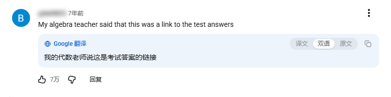
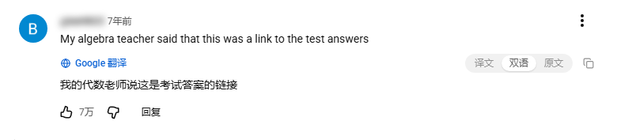

# yt-native-translator

用于 YouTube 网页端评论区的增强翻译用户脚本。直接复用官方评论区原生翻译接口，无需配置第三方 API Key 或自建代理。

架构沿用姊妹项目 [x-native-translator](https://github.com/Noctyn/x-native-translator)（X/Twitter 版）：基于同源 `fetch` 与当前登录会话，内置本地 LRU 缓存、悬停/自动双模式触发及三视图切换。

[](https://github.com/Noctyn/yt-native-translator) [](https://github.com/Noctyn/yt-native-translator) [](https://github.com/Noctyn/yt-native-translator) [](https://github.com/Noctyn/yt-native-translator/blob/main/LICENSE) [](https://github.com/Noctyn/yt-native-translator)

---

## 功能特性

- **免配置调用**：直接调用 YouTube 网页端自带的评论翻译接口（底层由 Google 翻译提供支持），无需配置任何外部密钥。
- **双模式触发与原生接管**：
  - **悬停翻译**：鼠标悬停于评论时触发，延迟可调（`0–1000 ms`），支持搭配 `Alt` / `Ctrl` / `Shift` 修饰键防误触。
  - **自动翻译**：基于 `IntersectionObserver` 与视口停留判定，滚动浏览时自动翻译可视区域内的主评论与楼中楼回复。
  - **隐藏原生按钮**：默认隐藏评论下方的官方「翻译成…」按钮以避免界面重复，关闭该选项即可恢复显示。
- **视图切换与主题适配**：
  - 译文框顶部（与「Google 翻译」标识同行）提供单条评论独立的「译文 / 双语 / 原文」切换入口；全局默认视图可通过设置面板或快捷键统一调整。
  - 内置**柔和卡片**（默认）、**细描边**、**无框**三款外观；通过采样评论正文前景色自动适配页面深浅色模式。
- **文本处理策略**：
  - **长评论分片**：超过 1200 字的长评论按行切分为多段分别请求并拼接，规避官方接口对超长文本的分段截断问题。
  - **同语言跳过**：基于 Unicode 书写系统（汉字、假名、谚文、西里尔字母等）判定语种，与目标语言一致时直接跳过请求。
- **缓存、限流与容错自愈**：
  - **缓存与并发调度**：内置本地 LRU 缓存（上限 1000 条 / 有效期 3 天，支持持久化存储与页面关闭前同步落盘）；请求队列限制最大并发为 2，按距视口中线距离优先调度。
  - **分级熔断与重试**：对 `429` / `401` 执行分级退避与静默重试；遇到 `400` / `404` / `405` 时先切换兜底 `clientVersion` 与兼容上下文自动重试一次，避免单条异常导致全局停摆；连续 3 条请求失败后暂停 2 分钟并提示原因，点击任意「重试」按钮可立即解除。

---

## 界面预览

| 柔和卡片（默认） | 细描边 | 无框 |
| :---: | :---: | :---: |
|  |  |  |

---

## 安装与配置

### 安装

请先在浏览器中安装用户脚本管理器：[Tampermonkey](https://www.tampermonkey.net/)（推荐）或 [Violentmonkey](https://violentmonkey.github.io/)，随后通过以下任一渠道安装：

- [Greasy Fork 安装地址](https://greasyfork.org/zh-CN/scripts/602312)（推荐）
- [GitHub Raw 直链安装](https://raw.githubusercontent.com/Noctyn/yt-native-translator/main/yt-native-translator.user.js)

> **权限与安全说明**：脚本仅申请 5 项基础 `GM_*` 权限（存储读写、样式注入、菜单注册、跨标签页同步）。所有网络请求均通过 `www.youtube.com` 同源 `fetch` 发起，无需声明 `@connect` 跨域权限，不向任何第三方发送数据。样式优先使用 `GM_addStyle` 或构造样式表（`adoptedStyleSheets`）注入，兼容 YouTube 的 CSP 策略。

### 配置入口与快捷键

脚本不在页面内注入悬浮球。可通过脚本管理器扩展菜单中的「YouTube 评论翻译设置」打开配置面板，或使用以下快捷键：

- `Alt + Shift + S`：打开 / 关闭设置面板
- `Alt + Shift + T`：切换全局显示模式（双语对照 / 仅译文 / 原文）
- `Alt + Shift + A`：立即翻译当前可视区域内的评论
- `Alt + Shift + P`：开启 / 关闭滚动自动翻译
- `Alt + Shift + C`：清空本地译文缓存

---

## 性能优化

评论区是 YouTube 页面中 DOM 变更最频繁的区域之一，脚本针对渲染与调度开销做了以下优化：

- **单例长驻 `IntersectionObserver`**：仅在初始化、SPA 路由跳转或配置变更时重建观察器，新增评论采用增量 `observe`，避免每次 DOM 变动重建观察器引发回调风暴与重复入队。
- **变更发现合并**：`MutationObserver` 对新增节点仅做 $O(1)$ 归属判定，每批次 DOM 变动最多对评论容器执行一次扫描，避免逐节点调用 `querySelectorAll`。
- **调度阶段零布局读取**：评论入队时记录一次距视口中线的距离，`pump` 调度出队时不再调用 `getBoundingClientRect`，避免批量入队触发 $O(n^2)$ 强制同步布局（Reflow）。
- **失败态标记隔离**：同一评论在相同目标语言下请求失败后将被标记，不再被滚动观察器反复触发重试，防止 `429` 限流时形成请求风暴。
- **缓存防抖落盘**：采用脏标记 + `15s` 防抖写入 + `pagehide` 事件同步落盘策略，避免每次获取译文都触发同步存储写入。
- **配置写入去重**：仅在用户主动切换显示模式时写入一次配置，挂载单条译文框时不触发存储操作。

仓库内置性能基准探针 `probe/perf.mjs`，用于在真实视频播放页模拟滚动评论区，采集长任务（Long Tasks）、掉帧率、观察器重建次数、布局读取与 CPU 采样热点：

```bash
node probe/perf.mjs dQw4w9WgXcQ --tag=after --scenario=auto-bilingual
node probe/perf.mjs dQw4w9WgXcQ --tag=before --script=probe/perf/before.user.js --scenario=auto-bilingual
```

支持场景：`baseline`、`auto-bilingual`、`auto-translation`、`visible-all`、`auto-long`、`baseline-long`。测试结果输出至 `probe/perf/<tag>-<scenario>.json` 并在终端打印摘要。

---

## 接口协议逆向说明

以下接口协议与边界结论均经 `cURL` 与 `patchright` 实测复核。

### 请求格式

接口复用当前域下 Cookie 鉴权，无需额外构造 `Authorization` 或 `SAPISIDHASH` 请求头：

```http
POST [https://www.youtube.com/youtubei/v1/comment/perform_comment_action?prettyPrint=false](https://www.youtube.com/youtubei/v1/comment/perform_comment_action?prettyPrint=false)
Content-Type: application/json

{
  "context": {
    "client": {
      "hl": "zh-CN",
      "gl": "US",
      "clientName": "WEB",
      "clientVersion": "2.20261023.01.00",
      "visitorData": "..."
    },
    "user": { "lockedSafetyMode": false },
    "request": { "useSsl": true, "consistencyTokenJars": [] }
  },
  "actions": [ "<base64url protobuf>" ]
}
```

### Action Token 结构（Protobuf）

`actions[0]` 为 Base64URL 编码的 Protobuf 消息，可直接由客户端构造而无需依赖抓包：

```text
f1  varint  22                 # 动作类型：22 代表翻译评论（0 / 1 / 3 均返回 400）
f31 message
    f2 bytes   commentId       # 评论 ID，例如 Ugw1tpIYg_PAwdPneep4AaABAg
    f3 message { f1 { f1 string 原文 } }
    f4 bytes   targetLanguage  # 目标语言代码：zh-CN / zh-TW / en / ja / ko / ru ...
    f5 varint  0
```

译文提取路径：`frameworkUpdates.entityBatchUpdate.mutations[].payload.commentEntityPayload.translatedContent.content`。

虽然网页端首屏评论响应的 `commentEntityPayload` 中通常带有 `isTranslationAvailable: true` 及预生成的 `translateData.translateComment`（内含上述 token），但本脚本不依赖该下发字段，而是直接提取 DOM 中的 `commentId`、评论原文与目标语言动态编码生成 token，从而不受首屏服务端下发状态限制。

其中 `commentId` 解析自评论时间戳链接 `span#published-time-text a[href*="&lc="]`。由于服务端**不校验** `commentId` 与评论正文的对应关系，当 DOM 解析失败时，脚本将自动退化为使用正文文本哈希作为占位 ID。

### 接口边界表现

| 测试条件 | 服务端响应结果 |
| :--- | :--- |
| 省略 `commentId` 或省略评论原文 | `400`（`invalid argument`） |
| 传入伪造的 `commentId` | `200`，正常返回译文 |
| 目标语言代码非法（如 `xx`） | `200`，但译文为空字符串（脚本按失败处理） |
| 目标语言字段留空 | `200`，回退按 `context.client.hl` 语种翻译 |
| 省略或留空 `context.client.clientVersion` | `404`（`Requested entity was not found`；脚本优先读 `ytcfg` 并内置兜底常量） |
| 省略 `context.client.clientName` | `400`（`invalid value`） |
| `clientName` 非 `WEB`（如 `WEB_MUSIC`） | `404` |
| `visitorData` 字段留空 | `200`，正常返回译文（脚本容错自愈机制依赖该特性） |
| 文本长度约 1300 字以内 | 完整返回译文 |
| 文本长度约 8000 字 | 译文出现分段丢字（故脚本设定按 1200 字分片） |
| `actions` 数组传入多个 token | 仅执行并返回第一条结果（不支持单请求批量） |
| 连续并发/串行连发 14 次请求 | 全部返回 `200`，未触发限流拦截 |

---

## 验证与回归探针（`probe/`）

`probe/` 目录包含用于复现接口契约与执行端到端回归测试的自动化脚本，运行需本机安装 `curl` 与 Node.js（执行 `npm i` 安装 `patchright`，可复用本地缓存的 Chromium）。

运行前需将会话 Cookie 写入 `probe/cookies.txt`（该文件及所有抓包产物均已配置在 `.gitignore` 中，不会被提交）：

```bash
node probe/capture3.mjs dQw4w9WgXcQ   # 打开视频页点击原生翻译按钮，抓取完整请求与响应报文
node probe/translate2.mjs             # 使用 cURL 复现 perform_comment_action 接口调用
node probe/limits.mjs                 # 测试语种、文本长度与请求字段边界矩阵
node probe/burst.mjs                  # 连续请求限流阈值测试
node probe/verify.mjs                 # 注入用户脚本执行端到端功能与视觉回归验证
node probe/interact.mjs               # 验证快捷键、错误态重试、缓存清理与 SPA 导航重置
node probe/longtest.mjs               # 验证超长评论分片请求与拼接完整性
node probe/themetest.mjs              # 验证深色 / 浅色主题自适应分支
node probe/perf.mjs                   # 滚动评论区性能探针（统计长任务、掉帧、观察器与布局读取）
node probe/repro-jp.mjs [vid]         # 日语视频端到端回归测试（捕获请求、译文与错误态）
node probe/self-heal.mjs              # 模拟上下文被拒，验证兼容上下文自愈逻辑
node probe/endpoint-fails.mjs         # 模拟接口 404，验证连续三次失败熔断与手动重试恢复
node probe/ui-check.mjs               # 检查无悬浮球、原生按钮隐藏、单条视图切换与快捷键
node probe/error-ui.mjs               # 验证「原文」视图下错误提示与重试按钮的可见性
node probe/inspect-native.mjs         # 提取网页原生「翻译成…」按钮的 DOM 结构
node probe/decode-action.mjs          # 解码 perform_comment_action 的 Protobuf 载荷
```

> **开发注意**：`patchright` 的 `addInitScript` 仅在页面实例的**首次**导航时生效，因此 `verify.mjs` 在每个测试步骤中均会创建新页面实例，而非在同一页面内重复调用 `goto`。

---

## 许可证

[MIT](LICENSE)
